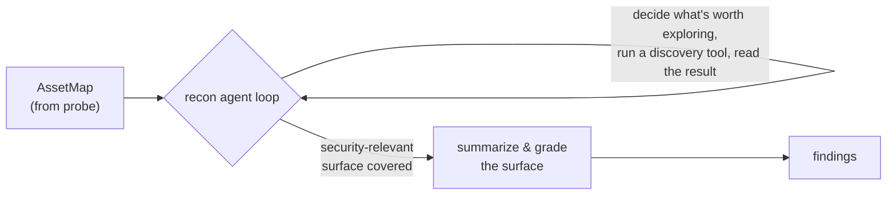
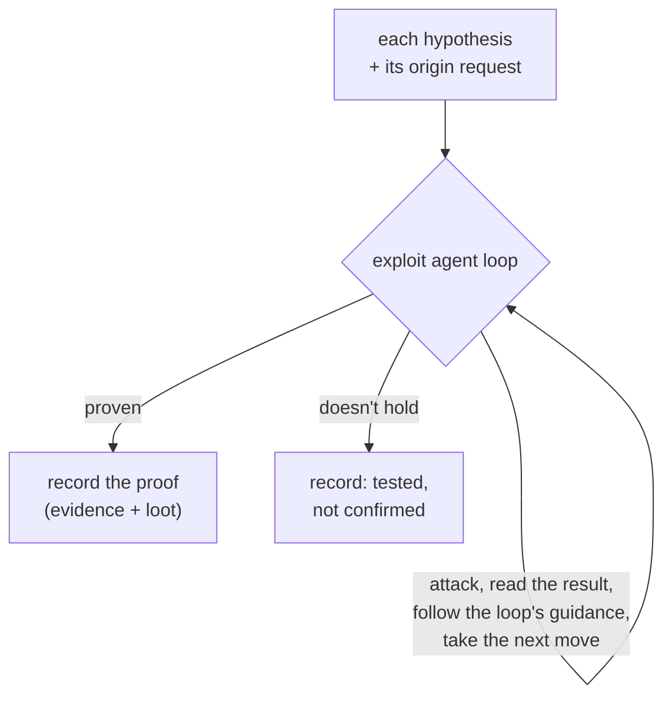

# APTS — Agentic Web-Application Penetration Testing

APTS is an autonomous, agent-driven system that penetration-tests web applications
end to end. It maps an app's attack surface, reasons about where the weaknesses
are, drives real security tools to exploit and prove them, and writes up the
results — as a pipeline of specialized agents, each responsible for one stage of a
real pentest workflow. Each stage hands a structured result to the next.

---

## What it does

### 1. Probe — the initial surface map
Every run starts with **probe**. It builds an **AssetMap**: a structured summary of
the web app's surface — its routes, the inputs on each page, and the API requests
the app makes. Probe runs a shallow browser crawl (`crawl_v2`) over the target and a
per-page **peek** that records what each page *is* and *does* (title, inputs,
buttons, the XHR/fetch calls it fires on load). Everything downstream reasons from
this map; it's the shared starting point.

### 2. Recon — the exploration agent
The **recon agent** takes probe's AssetMap and decides how to explore further. It
reasons about which parts of the surface are worth investigating and drives the
tool that fits each job:

- **`crawl_v2`** — a real headless browser that fills a page's inputs by type and
  submits them, capturing the *actual* request a form fires. Used on interactive
  pages (login, contact, upload, search).
- **`ffuf`** — fuzzes for unlinked paths and enumerable IDs a crawler can never
  reach (e.g. an IDOR endpoint `/api/note/FUZZ`, directories under `/api` or `/rest`).
- **`arjun`** — discovers hidden parameters an endpoint accepts but doesn't
  advertise — concrete injection points.
- **`katana`** — fast breadth crawl + JavaScript endpoint parsing.
- **`http_request`** — send one request to confirm what a route actually returns.

It reads what the tools return and summarizes them into **findings**: the concrete,
graded leads worth testing.



### 3. Vuln — hypothesis matching (RAG)
For each finding, the **vuln agent** runs a retrieval-augmented pass over a vector
database of security knowledge — the **HackTricks** corpus, for now. It pulls the
techniques relevant to that finding (`hacktricks_overview` to scan the technique
menu, `hacktricks_article` to fetch a specific write-up) and proposes candidate
**vulnerability hypotheses**: what might be wrong at this point in the app, and how
you would test it. Speculation is welcome here — the next stage is what separates a
real vulnerability from a guess.

### 4. MITRE mapping
The **mapping agent** tags each weakness with MITRE ATT&CK techniques, looking them
up against the ATT&CK catalogue (`attack_search`, `attack_technique`,
`attack_catalog`) so the report can speak in a framework defenders already use.

### 5. Exploit — the proof loop
The **exploit agent** turns hypotheses into attempts. It runs an agentic loop:
reason about the target, call a tool against it, read what came back, and decide the
next move — iterating until it has exploited and proven the vulnerability, or ruled
it out. Its tools:

- **`http_request`** — send a crafted request and judge the response.
- **`sqlmap`** — drive SQL-injection testing.
- **`xss_prove`** — fire an XSS attempt in a real browser and watch whether it lands.

The loop is not a blind retry. It carries **hints and guidance** that steer the
agent's tool calls:

- **coaching** — each tool result comes back with an observation summarizing what's
  been tried, so the agent builds on it instead of circling;
- **a repeat guard** — an exact repeat of a call short-circuits with a nudge to
  change approach rather than re-running the same thing;
- **session injection** — the engagement's credentials are attached to in-scope
  calls automatically, so a proof runs authenticated without the agent juggling the
  token;
- **target resilience** — a flaky target that drops a connection mid-proof is
  retried, so a crash isn't mistaken for a dead end.

That guidance is what makes the agent converge on a working exploit — and what lets
it recognize when a hypothesis simply doesn't hold.



### 6. Script & sandbox — proof-of-concept, safely
For a proven vulnerability, APTS can produce a proof-of-concept script and run it
inside a **hardened sandbox** (`sandbox_run`) — an isolated execution environment
that keeps untrusted, attack-shaped code away from your host. PoC code runs
contained, never on your machine.

### 7. Reporting
The **reporting agent** reasons over everything the run produced — it needs no
external tools — and compiles the proven findings into a client-facing report: it
groups related findings, ranks them by severity and impact, attaches the evidence
(the requests and responses that proved each one), carries the ATT&CK mapping, and
writes remediation guidance.

---

## How it's built

- **Agents over tools.** Each stage is an agentic loop over an LLM: the agent
  thinks, calls a tool, reads the result, and decides the next move.
- **Tools over MCP.** The security tooling — crawlers, `ffuf`, `arjun`, `katana`,
  `sqlmap`, `xss_prove`, the HackTricks knowledge base, the ATT&CK catalogue, the
  sandbox — lives behind a native **Model Context Protocol (MCP)** server, so the
  agents are decoupled from the tools they drive.
- **Structured artifacts.** Stages pass typed artifacts (AssetMap → findings →
  hypotheses → proofs → report), so results stay machine-readable the whole way.
- **Two ways to run it.** As a single-process pipeline (the `apts` runner), or
  driven by an AI coding agent (Claude Code / Codex) that calls the stages and
  tools over MCP.

---

## Quick start

**Prerequisites:** Docker + `docker compose`, Python 3.11+, and an LLM API key
(an OpenAI-compatible endpoint; the pipeline is provider-agnostic).

```bash
./scripts/setup.sh          # venv + dependencies + local secrets/certs
make up                     # start the tools server + database (containers)
# start an authorized target to test (e.g. a local OWASP Juice Shop), then:
apts run --target http://TARGET:PORT --scope TARGET
```

Run without a database (ephemeral, nothing persisted):

```bash
apts run --target http://TARGET:PORT --scope TARGET --storage memory
```

### Drive it from Claude Code / Codex
The repo ships an `.mcp.json`, so an AI coding agent picks up the APTS tools
automatically. Ask it to recon or pentest a target and it drives the stages for
you. See [CLAUDE.md](CLAUDE.md) for the full flow.

---

## Project layout

| Path | What's there |
|------|--------------|
| `apts/` | The runner and entry points — the single-process pipeline + the MCP control server |
| `agent/services/workers/` | The stage agents (recon, vuln, mitre, exploit, reporting) |
| `mcp_native/` | The MCP tools server (crawlers, ffuf, arjun, katana, sqlmap, xss, knowledge base, ATT&CK, sandbox) |
| `shared/` | Shared core — pipeline definition, data models, LLM client, scope rules |
| `.claude/` | Claude Code subagents and the pentest skill |
| `docker-compose.lean.yml` | The lean stack: tools server + database |
| `Makefile` | `setup`, `up`, `run`, `serve`, … |

---

## Safety & scope

APTS is for **authorized** testing only. Every outbound request is scope-checked,
credentials only ever reach in-scope hosts, and proof-of-concept code runs in the
sandbox. Only ever point it at a target you have permission to assess.
